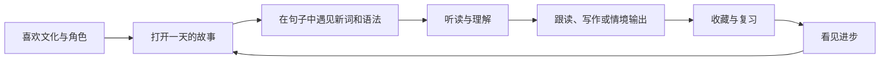

# Tori Korean 产品拆解与复刻方案

研究日期：2026-11-07（北京时间）。研究范围：官网、公开指南、会员说明、学习入口、公开前端资源及产品截图。没有使用原站账号，没有进入付款流程，没有访问非公开接口或付费课程。

## 1. 它在卖什么

它把“因为喜欢韩国文化而想学韩语”包装为一段小城生活：兔莉进入兽尔，在日记、街坊和生活场景中遇见语言。学习内容覆盖入门、故事课程和练习。公开页面显示的路径为 40 音、90 天日记、词汇与语法，再到听写和情境口语。[官网](https://torikorean.com/)

**产品判断：**核心价值是把学习动机从“我要完成课程”变成“我想知道兔莉接下来会发生什么”。课程是交付物，角色和世界观提供持续回来的理由。它面向的主要人群，推测是由韩剧、音乐、旅行或留学兴趣进入韩语学习的中文初学者；这属于对内容与视觉的推断，未获得用户统计证据。

## 2. 双层产品结构

| 层 | 用户来这里做什么 | 产品作用 |
| --- | --- | --- |
| 品牌官网 | 认识兔莉、逛动物城、看功能、了解会员 | 建立兴趣和信任，降低首次学习的心理门槛 |
| 学习中心 | 学发音、课程、词汇、语法、练习 | 持续产生学习结果，积累进度与收藏 |
| 个人与会员 | 看记录、复习、了解权益 | 承接长期留存和商业转化 |

官网不是简单的功能目录。它把“出发前夜—白天学一句—下午交朋友—晚上阅读”排成一段生活时间线。这个编排让很多功能看起来属于同一个世界，而不是一堆互不相干的工具。

复刻时保留这种双层结构：展示页维持叙事，学习页强调稳定导航、清晰进度和可重复使用的操作。

## 3. 学习闭环为什么成立



**设计建议：**每篇课程应使用相同的目标表达，贯穿故事、例句和测验。学习者第二次见到同一句话时，应能感受到熟悉度的增加。故事只能引人开始；真正的留存还需要复习计划、可靠音频和内容梯度。

本项目落实的最小闭环：一篇日记 → 收藏故事里的词 → 系统朗读 → 随堂语法题 → 写一句话 → 单词到期复习 → 学习记录更新。每一步都有可保存的数据，而不仅仅是一个页面入口。

## 4. 情绪与视觉如何服务学习

- 统一人物、地点和物件，减少用户认识不同模块的成本。
- 大标题和宽留白用于官网叙事；学习页使用小卡片和稳定侧栏，便于反复进入。
- 奶油底色、柔和粉紫色、纸张与明信片让学习更接近日常记录。
- 插画承担世界观；按钮和进度保持简单，不应让动画遮住学习任务。
- “从一句开始”的语气把目标拆小，适合刚入门时容易产生挫败感的用户。

这些是设计分析，并非经实验验证的因果结论。复刻版本沿用视觉方向；学习内容与功能独立实现。

## 5. 免费体验与会员转化

公开会员页区分月度、年度与永久方案，权益同时覆盖学习内容、AI 使用额度与学习支持。永久方案强调长期使用、更新、答疑和资料；页面也说明了免费体验范围。部分促销文案带历史截止日期，应以原站实际结算页为准，不能据此推断当前成交价格。[会员说明](https://torikorean.com/pricing/)

**商业判断：**这形成三个层次：低门槛体验验证“我喜欢这种学法”；付费解锁更完整的学习；长期方案通过陪练与支持增加承诺感。实际转化率、收入和用户留存并未公开，不能从页面推算。

**实现建议：**真正上线收费版本时，会员权益必须由服务端验证；订单回调应做签名校验和幂等处理。不能只靠前端隐藏按钮控制权限。永久会员如果包含不限量模型使用，需要先测算每位活跃用户的推理与语音成本。本项目不收款，也不伪造会员状态。

## 6. 技术拆解：观察与推断分开

| 观察到的公开证据 | 能支持的判断 | 不能由此确定 |
| --- | --- | --- |
| 官网返回完整 HTML，同时引用带哈希的 JS/CSS | 官网有预渲染或服务端生成能力，兼顾搜索与首屏 | 具体服务端框架和部署供应商 |
| 学习页引用 `/_expo/static/js/web/` 资源 | 学习端使用 Expo Web 的构建产物 | 移动端是否共享全部代码 |
| 公开代码出现进度、身份状态和课程续学逻辑 | 课程与用户进度有独立的数据层 | 真实数据库表、服务端安全策略 |
| 对话页面与截图展示语音、纠正和收藏 | AI 设计进入了学习流程 | 模型厂商、提示词、质量评估与成本 |

因此，下载公开前端资源不等于拿到了整个产品。服务端身份、订单、语音、模型、课程内容和用户数据都需要单独建设。

## 7. 本项目如何实现

采用静态托管优先的架构，以满足用户指定的 GitHub 部署目的。

```text
公开展示页面（HTML + 原站公开视觉资源）
                    ↓
独立学习应用（原生 JS 模块 + CSS）
    ├─ learning-data.js：独立课程与题库
    ├─ learning-state.js：复习计划、连续天数、记录校验
    ├─ learn.js：路由、课程、答题、收藏、导入导出
    └─ localStorage：当前浏览器的学习记录
                    ↓
GitHub Actions → 测试 → 构建 → 资源检查 → GitHub Pages
```

这样无需把任何密钥放到网页里，部署结果可以独立运行。代价是当前无法跨设备同步，也没有真实生成式 AI 和支付。

## 8. 如果把它发展成正式产品

建议先确认一条最重要的路径，而不是同时扩展所有模块：

1. **内容闭环。**补足连续 30 天的原创课程，给每篇指定词汇、目标语法和验收练习；请韩语教师校对。
2. **可靠学习数据。**加入账号、服务端进度、导入合并、离线冲突处理和备份。
3. **可控的 AI。**服务端调用模型；明确纠错标准；保留标准答案和人工评估集，跟踪错误纠正是否可信。
4. **语音体验。**使用经授权的韩语音频或稳定 TTS，逐句时间轴，再建设录音与评测。
5. **权益与经营。**接入支付与服务端会员校验，定义退款、额度和支持范围，再开放付费。

建议观察：首次学习完成率、次日与第七日回访、复习完成率、有效口语回合数和付费后的真实学习频率。它们是建议采集的指标，并非原站已披露的数据。

## 9. 复刻的边界

官网公开外观可高度贴近；完整行为“一模一样”需要原站课程数据、账号后台、AI 服务、付费逻辑和跨平台代码。当前交付是公开页面的视觉复现加独立可用的学习系统，不将有限的演示数据冒充原站完整课程。具体差异见 [实现清单](IMPLEMENTATION.md)。
